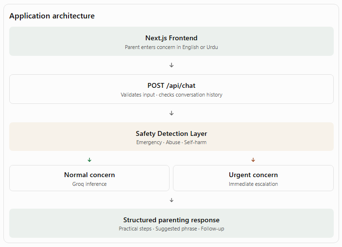

# Little Steps — Parenting Support Coach

A small Next.js app that gives parents brief, practical, non-diagnostic support in English or Urdu, using Groq Cloud inference.



## Requirements

- Node.js 20.9+
- A Groq API key: https://console.groq.com/keys

## Run locally

```bash
npm install
cp .env.example .env.local
```

Add your key to `.env.local`:

```env
GROQ_API_KEY=your_actual_key
GROQ_MODEL=openai/gpt-oss-20b
```

Then:

```bash
npm run dev
```

Open http://localhost:3000.

## How it works

- `src/app/page.tsx`: chat UI and in-memory conversation history.
- `src/app/api/chat/route.ts`: server-side Groq request, input validation, bounded conversation context.
- `src/lib/safety.ts`: deterministic first-pass keyword checks for emergency, abuse, and self-harm signals. These bypass the model and return an escalation response.
- The Groq system prompt constrains ordinary responses to a short plan, a suggested phrase, and one follow-up.

The API key is read only on the server. Do not prefix it with `NEXT_PUBLIC_`.

## Safety limitations — read before real-world use

This is a prototype, not a safeguarding or crisis-response product. Keyword screening can miss emergencies, abuse disclosures, indirect language, spelling variations, and other languages/dialects. It can also flag benign wording. A language model can produce incorrect or unsafe content despite the system prompt.

Before public deployment:
1. Have child-safety, clinical, and legal professionals review the content and escalation policy.
2. Add a robust, independently evaluated moderation/safeguarding layer and test it with realistic English and Urdu scenarios.
3. Add privacy disclosures, retention controls, abuse prevention, rate limiting, monitoring, and an incident-response process.
4. Configure locally appropriate emergency and child-protection resources only after verifying them.
5. Do not present the app as a substitute for professional support.

No login or database is used. Conversation history lives only in React state and is lost on refresh.
